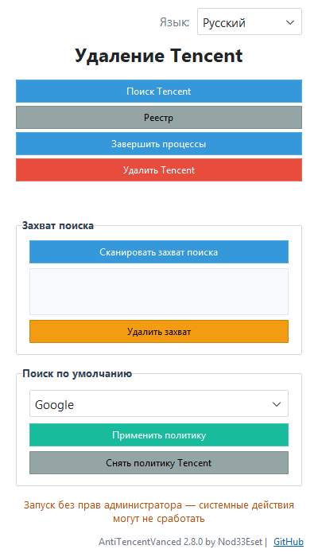

# AntiTencent Vanced

**🇬🇧 English** | [🇷🇺 Русский](README.ru.md) | [🇺🇦 Українська](README.uk.md) | [🇰🇿 Қазақша](README.kk.md) | [🇩🇪 Deutsch](README.de.md) | [🇫🇷 Français](README.fr.md) | [🇪🇸 Español](README.es.md) | [🇵🇱 Polski](README.pl.md) | [🇹🇷 Türkçe](README.tr.md) | [🇨🇳 中文](README.zh.md)

## 🌐 Forks

<a href="https://github.com/retvil/AntiBaiduVanced"> AntiBaiduVanced</a>  |  <a href="https://github.com/retvil/AntiSogouVanced"> AntiSogouVanced</a>  |  <a href="https://github.com/retvil/Anti2345Vanced"> Anti2345Vanced</a>  |  <a href="https://github.com/retvil/AntiUCWebVanced"> AntiUCWebVanced</a>  |  <a href="https://github.com/retvil/AntiNaverVanced"> AntiNaverVanced</a>  |  <a href="https://github.com/retvil/AntiKakaoVanced"> AntiKakaoVanced</a>  |  <a href="https://github.com/retvil/AntiQQVanced"> AntiQQVanced</a>  |  <a href="https://github.com/retvil/AntiWeChatVanced"> AntiWeChatVanced</a>  |  **AntiTencentVideoVanced**  |  <a href="https://github.com/retvil/AntiVKGroupVanced"> AntiVKGroupVanced</a>  |  <a href="https://github.com/retvil/AntiYandexVanced"> AntiYandexVanced</a>

## Was ist das?

Tencent installiert nicht nur einen Browser — es trägt sich still über vierzig Systemmechanismen als Standardsuche und Standardbrowser ein: Registry-Assoziationen, Enterprise-Richtlinien, Profileinstellungen von Browsern, sogar Suchmaschinen-Datenbanken in Chromium-Profilen. Allein das Entfernen des Browsers macht das nicht rückgängig.

**AntiTencent Vanced** (ein Fork von [retvil/AntiYandexVanced](https://github.com/retvil/AntiYandexVanced)) findet **alle 28/39 Hijack-Vektoren**, entfernt sie mit einem Klick und **verriegelt dann Ihre Standardsuche** hart auf eine von Ihnen gewählte Suchmaschine über Windows-Enterprise-Richtlinien — damit nichts sie laut zurückholen kann.

## Funktionen

- **Hijack-Scanner** — erkennt 28 Vektoren (VANCED) / 39 Vektoren (EXTENDED): Installationspfade, Uninstall-Registry-Einträge, `UserChoice`-Assoziation, `StartMenuInternet`-Registrierungen, `Software\Tencent`-Schlüsselbäume, Hijack über `DefaultSearchProvider*`-Richtlinien, Chromium-Profil-`Preferences`, Schlüsselwörter in `Web Data` (SQLite), Firefox `search.json.mozlz4`, Legacy-`SearchScopes`, Autostart-Einträge, geplante Aufgaben, Windows-Dienste, IME Switcher, Dateizuordnungen, Tencent-Disk-Shell-Integration, deaktivierter Autostart, App Paths, Verknüpfungen, ProgramData/Roaming-Reste, hosts-Einträge, Firewall-Regeln, URI-Protokolle, Browser-Erweiterungen, tencent.ru-Cookies, „Öffnen mit“-Zuordnungen, Prefetch/WER-Spuren, Defender-Ausschlüsse, Tastaturlayouts, IE-Startseiten-Hijack, Richtlinien für Start-URLs (`RestoreOnStartupURLs`), Firefox-Startseite, IE-Zonemap, RegisteredApplications-Einträge, MUICache-Spuren, %TEMP%-Installer, Store-Apps (Tencent Music), Produktverzeichnisse, lokale Datenverzeichnisse, Tencent.DNS
- **Entfernung mit einem Klick** — jeder Vektor hat seinen eigenen Remover; gesperrte Datenbanken werden ehrlich gemeldet, ohne Abstürze
- **Harte Suchrichtlinie** — verriegelt die Standardsuche auf eine von 10 Suchmaschinen (Google, Bing, DuckDuckGo, Brave Search, Startpage, Mojeek, Qwant, Ecosia, Yahoo, SearXNG) über HKLM-Richtlinien für Chrome, Edge, Brave, Vivaldi, Opera und Tencent Browser + `policies.json` für Firefox/Waterfox
- **Richtlinien-Bereinigung** — entfernt Tencent-`DefaultSearchProvider*`-Werte aus der Registry
- **10 UI-Sprachen** — ru, en, uk, kk, de, fr, es, pl, tr, zh; Systemsprache wird automatisch erkannt
- **Leichtes UI** — ttkbootstrap, vertikales Layout, fixierte Statusleiste und Fußzeile

## Screenshot

<details>
<summary>Hauptfenster</summary>



</details>

## Fertige Builds

Download von [Releases](https://github.com/retvil/AntiTencentVanced/releases):

- **Windows** — `AntiTencentVanced.exe` (portabel, eine Datei, ~35 MB) — entfernt Tencent Browser und die Tencent-Suche
- **Windows** — `AntiTencentExtended.exe` (portabel, eine Datei, ~35 MB) — Entfernung aller Tencent-Produkte (Tencent Disk, ime-Switcher-Verlauf, systemweite Spuren, Store-Apps, Tencent.DNS)

Als **Administrator ausführen** — HKLM-Richtlinien und Registry-Bereinigung erfordern erhöhte Rechte.

## Installation aus dem Quellcode

Python 3.10+ erforderlich ([python.org](https://python.org)).

```bash
git clone https://github.com/retvil/AntiTencentVanced.git
cd AntiTencentVanced
pip install psutil ttkbootstrap
python main.py
```

Eigenes EXE bauen: `build.bat` ausführen (PyInstaller, Ergebnis in `dist/`).

## Verwendung

1. **Prozesse beenden** → **Tencent suchen** → **Tencent löschen** — den Browser selbst entfernen.
2. **Such-Hijacks scannen** — zeigt alle Wege, wie Tencent sich ins System eingegraben hat.
3. **Hijacks entfernen** — zuerst alle Browser schließen, dann alles Gefundene entfernen.
4. Suchmaschine wählen → **Richtlinie anwenden** — die Standardsuche ist auf Systemebene verriegelt.

## FAQ

- **Warum Administrator?** Suchrichtlinien liegen in HKLM, die Hijack-Bereinigung berührt die System-Registry — erhöhte Rechte nötig.
- **„Database locked" in den Ergebnissen?** Während der Bereinigung lief ein Chromium-Browser. Alle Browser schließen und die Entfernung wiederholen.
- **Wie entferne ich die Suchrichtlinie?** Die Schaltfläche **Tencent-Richtlinien entfernen** räumt die Richtlinienwerte weg; in Firefox kann man zusätzlich die Datei `distribution\policies.json` löschen.

## Autor & Support

Изначальная идея: [retvil/AntiYandexVanced](https://github.com/retvil/AntiYandexVanced)

Wenn dich das Tool von Tencent befreit hat, kannst du die Entwicklung unterstützen:

**Krypto:**

- BTC: `bc1qunld3rsp37qf5gg69aune50y0qqkd0eugg7j97`
- TON: `UQDmvr4SKOxSION3Yky6aOgzAnCDXySPuAbG4EKJa5JUT7tC`
- USDT (TRC20): `TBPJSSLu1mUcX54g9UyxUohYGf2fuRvbwd`
- USDT (ERC20): `0x25CAED3776Ef5b18E03392bC5b254Bbd78E8180C`
- USDT (SOL): `3qgN5z291CEcj2FUi2Zza5DioxKgNw72kC7P52pCcTrG`

## Lizenz

MIT — siehe [LICENSE](../LICENSE).


